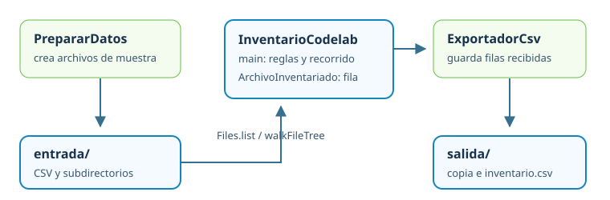

# Práctica guiada: organizar e inventariar directorios

Una productora recibe entregas en distintas carpetas. Necesita conservar una copia de `clientes.csv` y entregar un inventario de los CSV recibidos: ruta relativa, tamaño, modificación y un resumen. El programa debe aceptar `.csv` en cualquier combinación de mayúsculas, recorrer hasta cuatro niveles, ordenar las filas, registrar incidencias y guardar el informe **fuera** de la carpeta examinada.

Al terminar, `trabajo-codelab/salida/copias/clientes.csv` será la copia y `trabajo-codelab/salida/inventario.csv` contendrá cuatro filas de muestra. La suma de sus tamaños será **22 bytes** y el mayor será `historico/2025/marzo.CsV` (8 bytes; Windows puede mostrar `\` entre componentes). Tu programa estará en `InventarioCodelab.java`; la solución tiene esa misma clase principal.

<div class="mjs-progress-panel" role="status" aria-live="polite"><span class="mjs-progress-label">Tu avance en esta práctica</span><strong class="mjs-progress-count">0 de 11 pasos</strong><div class="mjs-progress-track"><div class="mjs-progress-fill"></div></div></div>

<div class="mjs-resources">
<a class="mjs-code-resource" href="/fp-dam2-acda/descargas/codigo/inventario-directorios-inicial.zip" download="inventario-directorios-inicial.zip"><span class="mjs-code-resource__icon" aria-hidden="true">&lt;/&gt;</span><span class="mjs-code-resource__body"><strong>Descargar proyecto inicial</strong><small>Código preparado para completar en IntelliJ.</small></span><span class="mjs-code-resource__format">ZIP</span></a>
<a class="mjs-resource-source" href="https://github.com/MJSPlayground/fp-dam2-acda/tree/main/proyectos/ficheros/codelab-inicial">Ver código en GitHub</a>
</div>

`PrepararDatos` crea la entrada; lo ejecutarás una vez antes del inventario. `InventarioCodelab` contiene el `main`, el recorrido y el modelo de cada fila. `ExportadorCsv` recibe esas filas y escribe el informe. Este primer proyecto no usa capas `dao` ni `service`: esas responsabilidades se muestran más adelante en el laboratorio compartido.

<figure class="mjs-figure" markdown="span">
  
  <figcaption>Las tres clases del primer codelab y el camino desde la entrada hasta el informe.</figcaption>
</figure>

## 1. Preparar el proyecto y los datos { .mjs-step-heading }

Descarga el **proyecto inicial** de la tarjeta anterior, extrae el ZIP y abre **la carpeta extraída que contiene `pom.xml`** con *File → Open* de IntelliJ IDEA. Espera la sincronización Maven y selecciona el JDK 25 en *File → Project Structure → Project*. La [guía de IntelliJ](../ayuda/proyectos-maven.md) detalla estos pasos. El starter compila, pero aún no inventaría nada. `PrepararDatos.java` ya está dentro de ese proyecto; no requiere otra descarga.

En *Project*, abre `src/main/java/es/mjsplayground/acda/ficheros/codelab/PrepararDatos.java` y pulsa el triángulo verde junto a `main` → **Run 'PrepararDatos.main()'**. Lee la ruta absoluta en *Run* y abre `trabajo-codelab/entrada` en el panel *Project*; actualiza la carpeta si hace falta. El *Working directory* debe ser la carpeta que contiene `pom.xml`.

`PrepararDatos` crea `clientes.csv`, `ventas.CSV`, `notas.txt`, dos CSV en subdirectorios y una carpeta vacía. Los CSV miden 4, 4, 6 y 8 bytes. Si vuelves a pulsar Run, conserva los datos y te lo comunica. Para una muestra nueva, indica una ruta de carpeta que todavía no exista en *Run → Edit Configurations → Program arguments*. Los datos se crean fuera de `src/main/resources` porque vamos a copiarlos y a provocar incidencias con ellos.

<div class="mjs-task"><input type="checkbox" id="b1-p1"><label for="b1-p1">He abierto el proyecto en IntelliJ, ejecutado PrepararDatos con Run y veo la entrada y la carpeta vacía.</label></div>

## 2. Construir rutas sin adivinar la carpeta de trabajo { .mjs-step-heading }

Abre `InventarioCodelab.java` y pulsa el triángulo verde junto a `main` → **Run 'InventarioCodelab.main()'**, sin argumentos. El `main` inicial muestra el directorio de trabajo, la entrada y la salida predeterminadas, y el filtro `csv`. Si la ruta no es la carpeta extraída que contiene `pom.xml`, corrige *Working directory* en *Run → Edit Configurations*. Puedes cambiar las rutas y el filtro en el código al explorar alternativas. Los tres argumentos son opcionales. `Path.of(...)` construye una ruta; **todavía no abre** esa carpeta. En `InventarioCodelab.main`, sustituye **`TODO 2`** por la validación física antes de modificar nada:

```java
if (!Files.isDirectory(origen)) {
    throw new IOException("La entrada no es un directorio: " + origen.toAbsolutePath());
}
```

Importa `java.nio.file.Files` y `java.io.IOException`. Comprueba el error cambiando temporalmente el valor predeterminado de `origen` por `trabajo-codelab/ausente`, pulsa Run y luego restáuralo. Una ruta inválida debe detener esta ejecución; no debe crear un informe vacío que parezca correcto.

<div class="mjs-task"><input type="checkbox" id="b1-p2"><label for="b1-p2">Distingo la ruta relativa, el directorio de trabajo y el error de entrada inexistente.</label></div>

## 3. Crear la salida y copiar sin sobrescribir { .mjs-step-heading }

En **`TODO 3`**, antes de escribir, comprueba que la salida no está dentro de la entrada. Si lo estuviera, la copia podría aparecer en el inventario y alterar el resultado. Después construye `trabajo.resolve("copias")` y usa `Files.createDirectories`: crea tanto `salida` como `copias` si faltan. `Files.copy` recibe origen y destino; no sustituye un archivo ya existente sin una opción explícita.

```java
if (trabajo.toAbsolutePath().normalize().startsWith(origen.toAbsolutePath().normalize())) {
    throw new IllegalArgumentException("La salida debe quedar fuera de la entrada");
}
Path copias = Files.createDirectories(trabajo.resolve("copias"));
Path muestra = origen.resolve("clientes.csv");
Path copia = copias.resolve("clientes.csv");
Files.copy(muestra, copia);
```

Comprueba el caso erróneo cambiando temporalmente `trabajo` por `origen.resolve("salida")`: Run debe detenerse **sin crear esa carpeta**. Después restaura la salida original. La solución añade una comprobación de rutas reales para detectar también enlaces simbólicos.

Al acabar, compara el contenido de las dos copias. Pulsa Run otra vez: debe aparecer `FileAlreadyExistsException`. Captura **ese caso concreto** para mostrar «La copia ya existe» y conservarla. Como exploración, usa `StandardCopyOption.REPLACE_EXISTING` solo con la opción explícita `--reemplazar`. La solución admite esta opción en `InventarioCodelab`.

Después de observar el fallo, rodea la copia con `try { ... } catch (FileAlreadyExistsException ex) { System.out.println("Conservo la copia existente: " + copia); }`. Así podrás volver a ejecutar los pasos siguientes sin perder la copia anterior. Importa `java.nio.file.FileAlreadyExistsException`.

??? tip "Pista: seleccionar la opción"
    Puedes usar `if (args.length == 4 && "--reemplazar".equals(args[3]))` para elegir entre dos llamadas a `Files.copy`. La ejecución normal desde Run no requiere argumentos. Importa `java.nio.file.StandardCopyOption`.

<div class="mjs-task"><input type="checkbox" id="b1-p3"><label for="b1-p3">La primera copia funciona y he comprobado qué ocurre al repetirla.</label></div>

## 4. Reconocer primero los archivos de un nivel { .mjs-step-heading }

En **`TODO 4`**, antes de descender por el árbol, usa `Files.list(origen)` dentro de `try-with-resources`. Devuelve un `Stream<Path>` de entradas directas; ciérralo para liberar el directorio. Muestra nombres ordenados:

```java
try (Stream<Path> entradas = Files.list(origen)) {
    entradas.sorted().forEach(p -> System.out.println(origen.relativize(p)));
}
```

Importa `java.util.stream.Stream`. Debes ver también `historico` y `vacio`, pero **no** `historico/enero.csv`: ese archivo está en otro nivel. Este pequeño resultado ayuda a distinguir listar de recorrer.

<div class="mjs-task"><input type="checkbox" id="b1-p4"><label for="b1-p4">He comprobado que `Files.list` solo muestra el primer nivel.</label></div>

## 5. Recorrer y seleccionar CSV { .mjs-step-heading }

`Files.walk(origen, 4)` sería suficiente para explorar un árbol pequeño. Prueba temporalmente ese stream y cuenta las rutas; recuerda que la raíz tiene profundidad cero. Para el inventario definitivo necesitamos continuar cuando falle una entrada. Cambia a `Files.walkFileTree`: `visitFile` recibe el archivo y sus atributos ya leídos; `visitFileFailed` recibe la ruta y el error. Las listas `filas` e `incidencias`, el sufijo y el esqueleto `visitante` ya están preparados en `main`. Completa **`TODO 5`** dentro de `visitFileFailed` y después sustituye el `TODO 5` situado tras el visitante por la llamada:

```java
// Dentro de visitFileFailed, antes de CONTINUE:
incidencias.add(p + ": " + e.getMessage());

// Tras declarar visitante:
Files.walkFileTree(origen, EnumSet.noneOf(FileVisitOption.class), 4, visitante);
```

`ArchivoInventariado` ya está preparado como `record` dentro de `InventarioCodelab`, con `Path relativa`, `long bytes` e `Instant modificado`. Importa `java.nio.file.Files`, `FileVisitOption` y `java.util.EnumSet` con ayuda del IDE. Añade `postVisitDirectory` si quieres registrar un error al terminar de leer una carpeta. No seguimos enlaces simbólicos.

No tienes que crear otra clase para este modelo de datos. El compilador genera automáticamente el constructor y los accesores `relativa()`, `bytes()` y `modificado()`.

??? tip "Pista: un fallo al cerrar una carpeta"
    Sobrescribe `postVisitDirectory(Path p, IOException e)`; si `e != null`, agrégalo a `incidencias`, y devuelve `CONTINUE`. La raíz inexistente se valida antes y sigue siendo un error que detiene la ejecución.

<div class="mjs-task"><input type="checkbox" id="b1-p5"><label for="b1-p5">He distinguido `Files.list`, `Files.walk` y el visitante que puede registrar fallos.</label></div>

## 6. Guardar tamaño, fecha y ruta relativa { .mjs-step-heading }

En el visitante de **`TODO 5`**, completa **`TODO 6`** dentro de `visitFile`: comprueba `a.isRegularFile()` y compara **solo el nombre** con el sufijo en minúsculas. `a.size()` devuelve bytes; `a.lastModifiedTime().toInstant()` da la fecha. `origen.relativize(p)` evita que el informe dependa de una ruta absoluta del equipo.

```java
if (a.isRegularFile() && p.getFileName().toString()
        .toLowerCase(Locale.ROOT).endsWith(sufijo)) {
    filas.add(new ArchivoInventariado(origen.relativize(p),
            a.size(), a.lastModifiedTime().toInstant()));
}
```

Después del recorrido, añade temporalmente `filas.forEach(f -> System.out.println(f.relativa() + ": " + f.bytes()));` o inspecciona `filas` con Debug. Comprueba que se registran cuatro rutas, entre ellas `ventas.CSV` y `historico/2025/marzo.CsV`; ni `notas.txt` ni el directorio `vacio` son filas. Si falta el CSV más profundo, revisa cómo cuentas la profundidad desde la raíz. Valida que la extensión no esté vacía ni contenga separadores de ruta antes de formar `sufijo`.

<div class="mjs-task"><input type="checkbox" id="b1-p6"><label for="b1-p6">Obtengo cuatro CSV, con tamaños 4, 4, 6 y 8 bytes.</label></div>

## 7. Ordenar y calcular el resumen { .mjs-step-heading }

En **`TODO 7`**, recuerda que el sistema de ficheros no promete un orden de visita. Tras terminar el recorrido, ordena por el texto de la ruta relativa para que dos ejecuciones produzcan las mismas filas. Calcula la cantidad con `filas.size()` y suma los bytes con `mapToLong`. Para el mayor, define antes el desempate: entre tamaños iguales gana la ruta alfabéticamente menor.

```java
filas.sort(Comparator.comparing(f -> f.relativa().toString()));
totalBytes = filas.stream().mapToLong(ArchivoInventariado::bytes).sum();
```

Imprime el total y el mayor. Para la muestra, son **4 archivos y 22 bytes**. Modifica temporalmente dos archivos para que empaten en tamaño y comprueba que la selección no cambie entre ejecuciones. Si no hay archivos coincidentes, el total es cero y el mayor debe mostrarse como «ninguno», nunca provocar un error por intentar acceder a una lista vacía.

??? tip "Pista: desempate sin depender de la visita"
    Usa `max` con un comparador de `bytes` y después uno de ruta **invertido**, o recorre la lista ya ordenada y sustituye el mayor solo cuando el tamaño sea estrictamente superior. Así el primer nombre conserva el empate.

<div class="mjs-task"><input type="checkbox" id="b1-p7"><label for="b1-p7">El orden y las estadísticas son estables, también con empates y sin coincidencias.</label></div>

## 8. Exportar el informe fuera de la entrada { .mjs-step-heading }

El destino será `trabajo.resolve("inventario.csv")`. La separación entre entrada y salida ya se validó **antes de la primera copia**; así el informe no puede incluirse a sí mismo. Para escribir CSV con comillas correctas si un nombre contiene coma, ambos proyectos incluyen `ExportadorCsv`. Esta utilidad encapsula Apache Commons CSV; no necesitas estudiar todavía sus reglas internas. En **`TODO 8`**, úsala con las filas que has seleccionado.

```java
ExportadorCsv.guardar(informe, filas);
```

La utilidad cierra el escritor y la impresora, escribe las tres columnas y se ocupa de las comillas; el bloque de CSV profundizará en sus reglas. No necesitas imports adicionales porque ambas clases comparten paquete. Tras Run, busca `trabajo-codelab/salida/inventario.csv` en *Project*; actualiza la carpeta si no aparece. Debe tener cabecera y cuatro filas. El informe se regenera en cada ejecución y la copia existente se conserva. La solución comprueba también rutas reales para evitar que un enlace simbólico esconda una salida dentro de la entrada.

<div class="mjs-task"><input type="checkbox" id="b1-p8"><label for="b1-p8">El CSV contiene cuatro filas, está fuera de entrada y no se inventaría a sí mismo.</label></div>

## 9. Informar de incidencias con claridad { .mjs-step-heading }

Completa **`TODO 9`**: muestra cada elemento de `incidencias` al terminar en *Run*, sin tirar las filas válidas. Si no hay incidencias, muestra un mensaje breve. Prueba primero errores reproducibles: entrada inexistente, destino que sea un archivo y copia ya ocupada. Para investigar la entrada inexistente, pon un punto de interrupción en la validación del paso 2; para un destino que sea archivo, en `Files.createDirectories`; para la copia ocupada, en `catch (FileAlreadyExistsException ex)`. Pulsa **Debug** junto a `main`, observa la ruta y la excepción, y continúa con *Resume Program*. Esos casos no llaman a `visitFileFailed`: ese método recibe fallos **durante el recorrido**. Los permisos dependen del sistema operativo. No llames «archivo inexistente» a cualquier `IOException`.

En una prueba más avanzada puedes borrar un archivo entre su descubrimiento y lectura: `walkFileTree` comunicará ese fallo mediante `visitFileFailed` cuando el proveedor no consiga obtener atributos. Un fallo de acceso a la raíz puede impedir comenzar y debe detenerse. Conserva el mensaje original junto a la ruta para poder diagnosticarlo.

<div class="mjs-task"><input type="checkbox" id="b1-p9"><label for="b1-p9">He probado entradas incorrectas y distingo un fallo total de una incidencia parcial.</label></div>

## 10. Retos de aplicación { .mjs-step-heading }

1. Ejecuta el inventario con extensión `txt` sin modificar el código: en **Run → Edit Configurations → Program arguments** escribe `trabajo-codelab/entrada trabajo-codelab/salida txt` y pulsa Run. Predice las filas antes de abrir el informe: debe incluir solo `notas.txt` (8 bytes). El informe anterior se regenera. Borra después esos argumentos para volver al filtro CSV predeterminado.
2. Cambia el archivo `historico/2025/marzo.CsV` para que también tenga 4 bytes. Ahora hay varios máximos empatados: predice cuál gana con la regla alfabética y compruébalo.
3. Usa una carpeta de entrada vacía recién creada. Produce un informe con cabecera y cero filas, total cero y «ninguno» como mayor; después añade un CSV dentro de un quinto nivel y comprueba que sigue fuera del límite de profundidad.

Estos retos exigen combinar selección, rutas relativas y estadísticas. Prueba cada uno con una entrada que distinga un resultado correcto de uno accidental. Consulta las clases de referencia **después** de intentar tu diseño; no hay un fragmento de respuesta inmediata bajo los retos.

<div class="mjs-task"><input type="checkbox" id="b1-p10"><label for="b1-p10">He probado al menos un reto con datos que permitan detectar un error.</label></div>

## 11. Contrastar con la solución ejecutable { .mjs-step-heading }

Descarga la **solución completa** al final de esta página y abre la carpeta extraída como proyecto Maven independiente. Espera la sincronización y confirma el JDK 25. Abre `InventarioCodelab.java` del proyecto solución y pulsa el triángulo verde de `main` → **Run**. Ese único programa prepara la muestra si falta, organiza y copia `clientes.csv`, recorre y filtra, calcula el resumen y exporta el inventario. Compara en *Run* cantidad, suma y mayor; después abre `trabajo-codelab/salida/inventario.csv` y contrasta orden y filas con tu programa. El [README de esta solución](https://github.com/MJSPlayground/fp-dam2-acda/blob/main/proyectos/ficheros/codelab-solucion/README.md) explica el recorrido y sus clases. El proyecto inicial sigue incompleto en la lógica del ejercicio.

<div class="mjs-task"><input type="checkbox" id="b1-p11"><label for="b1-p11">He ejecutado la clase principal de la solución y comparado sus resultados con mi programa.</label></div>

<div class="mjs-resources">
<a class="mjs-code-resource" href="/fp-dam2-acda/descargas/codigo/inventario-directorios-solucion.zip" download="inventario-directorios-solucion.zip"><span class="mjs-code-resource__icon" aria-hidden="true">&lt;/&gt;</span><span class="mjs-code-resource__body"><strong>Descargar solución completa</strong><small>Proyecto terminado para ejecutar y comparar.</small></span><span class="mjs-code-resource__format">ZIP</span></a>
<a class="mjs-resource-source" href="https://github.com/MJSPlayground/fp-dam2-acda/tree/main/proyectos/ficheros/codelab-solucion">Ver código en GitHub</a>
</div>
