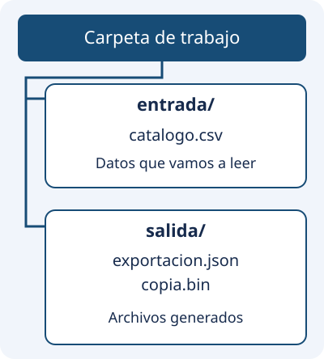

# Ficheros, directorios y rutas

Un programa puede tener productos en memoria mientras está abierto. Para recuperarlos después necesita guardarlos en algún almacenamiento. En este tema utilizamos archivos: cada uno conserva bytes en un sistema de ficheros, organizado mediante directorios.

Un directorio agrupa entradas que pueden ser otros directorios o archivos. El nombre `catalogo.csv` identifica una entrada dentro de su carpeta; para encontrarla necesitamos una **ruta**.

<figure class="mjs-figure" markdown="span">
  
  <figcaption>Separar entradas y salidas ayuda a conservar el original. Esquema conceptual del trabajo con archivos, no una captura de la aplicación.</figcaption>
</figure>

## Representar una ruta con Path

Antes de programar, abre el `pom.xml` del starter como proyecto Maven y espera a que IntelliJ resuelva sus dependencias. Maven reúne bibliotecas y ejecuta compilación y pruebas; no guarda el inventario. El Wrapper incluido permite utilizar la misma versión de Maven sin instalarla por separado. [Preparación de proyectos](../ayuda/proyectos-maven.md) explica JDK, importación y Run.

Localiza ahora `model/entity/Producto.java`, `model/repository/ArchivosRepository.java` y `model/service/InventarioService.java`, bajo `src/main/java/es/mjsplayground/acda/ficheros/inventario`. La entidad representa un producto; el repositorio accede a los archivos; el servicio valida y coordina lo que pide la interfaz. La UI está preparada. Esta separación permite aprender primero una operación pequeña sin escribir ventanas ni completar todos los formatos.

El registro técnico también está preparado: `LoggerFactory.getLogger(...)` obtiene un logger SLF4J y `src/main/resources/log4j2.xml` configura Log4j2. Por ejemplo, `log.error("No se pudo leer el catálogo", causa)` conserva la excepción para diagnosticarla. No conviertas una lectura fallida en una lista vacía ni uses `System.out.println` como sustituto del registro. Volveremos a la propagación de errores en [arquitectura](arquitectura.md).

En `InventarioService`, el campo ya entregado es:

```java
protected static final Logger log =
    LoggerFactory.getLogger(InventarioService.class);
```

Los imports `org.slf4j.Logger` y `org.slf4j.LoggerFactory` identifican la API. Dentro de los métodos del servicio puedes observar llamadas como estas:

```java
log.info("Catálogo guardado: {} productos en {}", productos.size(), archivo);
log.error("No se pudo leer el catálogo", causa);
```

`INFO` informa de una operación terminada; los `{}` reciben los valores sin concatenarlos. `ERROR` registra un fallo y recibe como último argumento la excepción `causa`, conservando su traza. `archivo` es la ruta de la operación y `causa` la excepción capturada. El logger no guarda productos ni muestra un aviso en la ventana: esas responsabilidades siguen separadas.

[`Path`](https://docs.oracle.com/en/java/javase/25/docs/api/java.base/java/nio/file/Path.html) representa una ubicación. No contiene los datos del archivo ni lo crea por sí solo. `Path.of` permite construirlo a partir de partes; `resolve` añade una ruta a otra.

```java
Path carpeta = Path.of("trabajo"); // (1)!
Path catalogo = carpeta.resolve("entrada").resolve("catalogo.csv");
```

1. Aquí solo creamos un objeto que representa una ruta. La carpeta `trabajo` puede no existir; el acceso físico se realizará después con `Files`.

El resultado representa `trabajo/entrada/catalogo.csv`, con los separadores adecuados al sistema. Los métodos devuelven nuevos objetos de ruta: construir `catalogo` no modifica `carpeta`.

Una ruta **absoluta** identifica su ubicación desde una raíz, como `C:\trabajo\entrada\catalogo.csv`. Una **relativa**, como la anterior, necesita un punto de partida. En Java se interpreta respecto al **directorio de trabajo del proceso**.

## Directorio de trabajo y diagnóstico

IntelliJ permite seleccionar el directorio de trabajo en la configuración Run. No tiene por qué ser la carpeta del `.java`. Esta comprobación permite inspeccionar dónde buscará una ruta relativa:

```java
Path trabajo = Path.of("").toAbsolutePath();
Path catalogo = Path.of("trabajo", "entrada", "catalogo.csv").toAbsolutePath();
```

Observa ambas variables en el depurador. Si el programa arranca desde otro lugar, cambia el prefijo de la segunda. Cuando un archivo parece haber desaparecido, comprueba primero si estabas buscando la misma ruta absoluta.

`getFileName()` devuelve el último componente; `getParent()`, el anterior. Para una ruta sencilla como `catalogo.csv`, el padre puede ser nulo. `normalize()` simplifica partes como `..` en la representación, pero no comprueba existencia ni permisos.

## Files realiza operaciones reales

[`Files`](https://docs.oracle.com/en/java/javase/25/docs/api/java.base/java/nio/file/Files.html) ofrece métodos estáticos para consultar o modificar el sistema. Estos fragmentos utilizan rutas de una carpeta de experimentación; no debes apuntarlos a archivos importantes:

```java
Path salida = Path.of("trabajo", "salida");
Files.createDirectories(salida);
Path copia = salida.resolve("catalogo-copia.csv");
Files.copy(Path.of("trabajo", "entrada", "catalogo.csv"), copia);
```

`createDirectories` prepara la carpeta y los padres necesarios. `copy` copia el contenido del origen y, sin una opción de reemplazo, rechaza que el destino ya exista. Esa protección obliga a decidir si queremos conservarlo antes de sobrescribir.

`Files.move(origen, destino)` mueve o renombra una entrada. `Files.delete(ruta)` elimina la entrada indicada y falla si no existe; `deleteIfExists` permite tratar la ausencia como un resultado normal. Estas operaciones no son demostraciones inocuas: deben probarse solo con datos de trabajo y confirmación de la aplicación cuando corresponda.

`Files.isRegularFile(ruta)` comprueba si una entrada representa un archivo regular; `Files.isDirectory` comprueba directorios. Una propiedad puede cambiar entre la consulta y la operación siguiente: `exists` no garantiza que una lectura posterior vaya a funcionar. La operación real siempre debe tratar su error.

## Listar el primer nivel sin recorrer todo el árbol

Para ofrecer los archivos CSV de una carpeta, basta con recorrer sus entradas directas. `DirectoryStream` permite hacerlo con un bucle y se cierra mediante `try-with-resources`:

```java
try (DirectoryStream<Path> entradas = Files.newDirectoryStream(carpeta)) {
    for (Path entrada : entradas) {
        if (Files.isRegularFile(entrada)
                && entrada.getFileName().toString().toLowerCase(Locale.ROOT).endsWith(".csv")) {
            // La interfaz puede añadir esta ruta al listado.
        }
    }
}
```

Este fragmento supone una variable `carpeta` válida. Solo observa archivos del primer nivel; no entra en subdirectorios ni calcula estadísticas de un árbol. Convertir el nombre a minúsculas permite reconocer también `.CSV`, sin cambiar el nombre real del archivo. La [referencia de DirectoryStream](https://docs.oracle.com/en/java/javase/25/docs/api/java.base/java/nio/file/DirectoryStream.html) explica su ciclo de vida.

No debe utilizarse este listado para dar apariencia de que un producto ya se ha importado. Seleccionar una ruta y leer su contenido son acciones distintas.

## Permisos y excepciones

Una operación puede fallar porque no existe la entrada, se deniega el acceso, el destino está ocupado o el formato no se puede interpretar. Las operaciones de ficheros pueden lanzar `IOException` y subtipos más concretos.

El programa debe informar de qué operación falló y conservar la causa para diagnosticarla. Una carpeta inaccesible no equivale a un listado vacío. En [arquitectura y errores](arquitectura.md) veremos cómo comunicarlo mediante servicios, excepciones propias y logging, sin llenar la aplicación de `System.out.println`.

## Recursos incluidos y datos modificables

Los ejemplos de `src/main/resources/data/` pertenecen al **classpath**: se empaquetan con la aplicación y se leen como recursos. No deben utilizarse como destino para el catálogo que modifica el usuario.

Para leer uno se utiliza `getResourceAsStream("/data/productos.csv")` sobre una clase del proyecto y se comprueba que el resultado no sea nulo. Los datos guardados por el usuario van a una ruta externa elegida en la interfaz. El [proyecto guiado](proyecto.md) muestra qué parte está preparada y dónde completar el listado.

Continúa con [texto y CSV](texto-csv.md).
