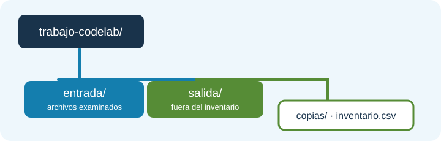

# Sistemas de ficheros y rutas

Antes de leer un archivo, un programa debe saber **dónde buscarlo**. Un sistema de ficheros organiza entradas en una estructura de directorios. Un *archivo* conserva bytes (por ejemplo, un CSV o una imagen); un *directorio* agrupa entradas, que a su vez pueden ser archivos u otros directorios. El nombre `clientes.csv` identifica una entrada dentro de su carpeta, pero por sí solo no dice en qué carpeta está.

```text
entregas/
├── clientes.csv
├── notas.txt
└── historico/
    └── clientes-2025.csv
```

La ruta `entregas/historico/clientes-2025.csv` describe cómo llegar al archivo desde un punto de partida. El diagrama también muestra por qué `clientes.csv` y `historico/clientes-2025.csv` no son el mismo archivo.

<figure class="mjs-figure" markdown="span">
  
  <figcaption>Figura 1. Separar entrada y salida evita que el informe se incluya en su propio inventario.</figcaption>
</figure>

## Ruta relativa, absoluta y directorio de trabajo

Una ruta **absoluta** comienza desde la raíz de un sistema de ficheros: en Windows podría ser `C:\datos\entregas`; en Linux, `/home/ana/entregas`. Una ruta **relativa**, como `entregas/clientes.csv`, necesita un punto de partida. Para un programa Java ese punto es el **directorio de trabajo del proceso**. IntelliJ permite configurarlo en la ejecución; no hay que suponer que sea siempre la carpeta donde está el `.java` ni `src/main/resources`.

[`Path.of`](https://docs.oracle.com/en/java/javase/25/docs/api/java.base/java/nio/file/Path.html#of(java.lang.String,java.lang.String...)) crea un objeto `Path` a partir de uno o varios componentes. `Path.of("")` representa el directorio de trabajo como ruta relativa vacía. [`toAbsolutePath`](https://docs.oracle.com/en/java/javase/25/docs/api/java.base/java/nio/file/Path.html#toAbsolutePath()) permite ver dónde se interpretará:

```java
System.out.println("Trabajo: " + Path.of("").toAbsolutePath());
Path datos = Path.of("entregas", "clientes.csv"); // (1)!
System.out.println("Buscaré: " + datos.toAbsolutePath());
```

1. `Path.of` solo representa la ruta. Si el archivo no existe, esta línea sigue funcionando; fallará después una operación física como `Files.size`.

Si el proceso arranca en `C:\proyectos\inventario`, la segunda línea termina en `C:\proyectos\inventario\entregas\clientes.csv`. En otro equipo cambiará el prefijo y quizá el separador. **Las llamadas anteriores solo construyen y muestran rutas; no comprueban si el archivo existe.** Para depurar un `NoSuchFileException`, imprime primero el directorio de trabajo y la ruta absoluta que intentaste abrir.

!!! tip "Separadores portables"
    `Path.of("entregas", "historico", "clientes-2025.csv")` deja al proveedor del sistema elegir el separador. Evita incrustar `C:\...` en ejercicios que deben funcionar en otros equipos. El texto mostrado por `Path` puede usar `\` o `/`; no compares la salida completa con una ruta propia de otro sistema.

## Construir y examinar una ruta

[`resolve`](https://docs.oracle.com/en/java/javase/25/docs/api/java.base/java/nio/file/Path.html#resolve(java.lang.String)) añade una ruta al final de otra y devuelve un **nuevo** `Path`; no modifica el original. Así puedes conservar la carpeta base y construir varias ubicaciones:

```java
Path entrada = Path.of("entregas");
Path csv = entrada.resolve("historico").resolve("clientes-2025.csv");
System.out.println(entrada);           // entregas
System.out.println(csv.getFileName()); // clientes-2025.csv
System.out.println(csv.getParent());   // entregas/historico
```

[`getFileName`](https://docs.oracle.com/en/java/javase/25/docs/api/java.base/java/nio/file/Path.html#getFileName()) devuelve el último componente como `Path`; [`getParent`](https://docs.oracle.com/en/java/javase/25/docs/api/java.base/java/nio/file/Path.html#getParent()) devuelve lo anterior, o `null` si no hay padre en la representación. `resolve` con una segunda ruta absoluta devuelve esa ruta absoluta: si aceptas datos del usuario, comprueba que un nombre esperado como `clientes.csv` no se convierte por sorpresa en otra ubicación.

[`normalize`](https://docs.oracle.com/en/java/javase/25/docs/api/java.base/java/nio/file/Path.html#normalize()) simplifica componentes `.` y `..` **solo en el texto de la ruta**:

```java
Path ruta = Path.of("entregas", "2025", "..", "clientes.csv");
System.out.println(ruta.normalize()); // entregas/clientes.csv
```

No crea carpetas, no sigue enlaces simbólicos y no garantiza que el archivo exista. [`toRealPath`](https://docs.oracle.com/en/java/javase/25/docs/api/java.base/java/nio/file/Path.html#toRealPath(java.nio.file.LinkOption...)) sí consulta el sistema y puede fallar con `IOException`. Para mostrar un nombre relativo al directorio inspeccionado, [`relativize`](https://docs.oracle.com/en/java/javase/25/docs/api/java.base/java/nio/file/Path.html#relativize(java.nio.file.Path)) calcula la parte restante: `entrada.relativize(csv)` produce `historico/clientes-2025.csv`. Ambas rutas deben ser compatibles (por ejemplo, ambas relativas).

## Representación frente a acceso real

`Path` es como escribir una dirección en un papel. [`Files`](https://docs.oracle.com/en/java/javase/25/docs/api/java.base/java/nio/file/Files.html) es la clase que crea, lee, copia o borra entradas físicas. `Path.of("desconocido.csv")` funciona aunque el archivo no exista; `Files.size` sobre esa ruta normalmente lanzará `NoSuchFileException`. Un archivo puede desaparecer o cambiar de permisos entre una comprobación y la operación siguiente. Por eso `Files.exists` sirve para informar, pero no sustituye el tratamiento de excepciones en la operación real.

## Recursos incluidos en la aplicación

Un archivo en `src/main/resources/data/` se empaqueta en el **classpath**: es adecuado para datos de muestra de solo lectura. Se localiza por su nombre lógico, incluso cuando la aplicación está dentro de un JAR. No se debe tratar como carpeta externa modificable.

```java
try (InputStream entrada = Ejemplo.class.getResourceAsStream("/data/clientes.csv")) {
    if (entrada == null) throw new FileNotFoundException("Falta /data/clientes.csv");
    // En el bloque de texto aprenderemos a leer su contenido.
}
```

[`getResourceAsStream`](https://docs.oracle.com/en/java/javase/25/docs/api/java.base/java/lang/Class.html#getResourceAsStream(java.lang.String)) devuelve `null` si no encuentra el recurso. Para un inventario, copias o informes que el usuario modifica, usaremos **rutas externas** entregadas como argumentos.
