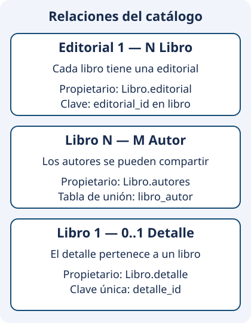

# Relaciones y ciclo de vida

El catálogo utiliza las tres cardinalidades del tema. No son tres formas de escribir la misma anotación: cada una expresa cuántos objetos pueden relacionarse y cómo se conserva esa asociación.

<figure class="mjs-figure" markdown="span">
  
  <figcaption>Las asociaciones del catálogo se escriben desde Libro; editoriales y autores conservan identidad independiente, mientras el detalle pertenece a su libro.</figcaption>
</figure>

## Editorial y libros: 1:N y N:1

Una editorial puede tener varios libros. Cada libro del proyecto debe tener una editorial. La clave foránea `editorial_id` se encuentra en la tabla `libro`, por lo que `Libro.editorial` es el **lado propietario**:

```java
@ManyToOne(optional = false, fetch = FetchType.LAZY)
@JoinColumn(name = "editorial_id", nullable = false)
private Editorial editorial;
```

En `Editorial`, la colección representa el lado inverso:

```java
@OneToMany(mappedBy = "editorial", fetch = FetchType.LAZY)
private Set<Libro> libros = new HashSet<>();
```

`mappedBy = "editorial"` es el nombre de la propiedad Java en `Libro`; no es el de una columna SQL. Le indica al proveedor dónde está el mapeo que escribe esa relación. Las APIs de [ManyToOne](https://jakarta.ee/specifications/persistence/3.2/apidocs/jakarta.persistence/jakarta/persistence/ManyToOne.html) y [OneToMany](https://jakarta.ee/specifications/persistence/3.2/apidocs/jakarta.persistence/jakarta/persistence/OneToMany.html) detallan ambos lados.

Para trasladar un libro se modifica su editorial dentro de una transacción. Cambiar únicamente una colección inversa en memoria no es una forma fiable de actualizar la clave foránea. En una operación que mantenga ambas referencias en memoria, hay que conservar también la coherencia de sus dos lados; una sesión nueva permite comprobar lo que realmente quedó persistido.

No se configura borrado en cascada desde editorial: eliminar una editorial con libros se rechaza. Suprimir un nombre del catálogo no debe arrastrar todos sus libros por una decisión de mapeo equivocada.

## Libros y autores: M:N

Un libro tiene de uno a cinco autores en este proyecto; un autor puede aparecer en varios libros. La base utiliza la tabla `libro_autor` con las claves de ambos.

`Libro.autores` es propietario y define la tabla de unión:

```java
@ManyToMany(fetch = FetchType.LAZY)
@JoinTable(name = "libro_autor",
    joinColumns = @JoinColumn(name = "libro_id"),
    inverseJoinColumns = @JoinColumn(name = "autor_id"))
private Set<Autor> autores = new HashSet<>();
```

El lado inverso en `Autor` utiliza `@ManyToMany(mappedBy = "autores")`. La [API de ManyToMany](https://jakarta.ee/specifications/persistence/3.2/apidocs/jakarta.persistence/jakarta/persistence/ManyToMany.html) explica la tabla de unión y la propiedad de la asociación.

Quitar un autor de un libro elimina su vínculo, no la fila del autor. El mismo autor puede seguir asociado a otro libro. Por eso no se añade `CascadeType.REMOVE` a esta relación para conseguir que un borrado «funcione».

Al crear un libro se recuperan autores existentes en la misma sesión; no se construyen copias con el mismo nombre esperando que Hibernate las reconozca como las mismas filas. Los IDs permiten elegir identidades concretas.

## Libro y detalle: 1:1 opcional

El detalle contiene idioma y páginas y pertenece a un libro. Puede faltar cuando aún no se conoce esa información. La asociación está en `Libro` y utiliza una clave foránea única:

```java
@OneToOne(fetch = FetchType.LAZY, cascade = CascadeType.ALL, orphanRemoval = true)
@JoinColumn(name = "detalle_id", unique = true)
private Detalle detalle;
```

La unicidad impide que varios libros compartan esa misma fila de detalle. Para duplicar una ficha en la práctica final habrá que crear un detalle independiente, conservando sus valores, en lugar de compartir su identidad.

La [API de OneToOne](https://jakarta.ee/specifications/persistence/3.2/apidocs/jakarta.persistence/jakarta/persistence/OneToOne.html) admite distintas disposiciones; el proyecto utiliza esta asociación unidireccional. No necesita añadir una referencia inversa desde `Detalle` para enseñar la cardinalidad.

## Cascadas y orphanRemoval

Una cascada propaga determinadas operaciones desde una entidad a otra. `PERSIST` permite persistir un dependiente al persistir su propietario; `REMOVE` propaga su eliminación; `ALL` agrupa las operaciones de cascada.

En `Libro.detalle`, esa dependencia es deliberada: el detalle no funciona como catálogo compartido. `orphanRemoval = true` elimina la fila del detalle que queda sin su libro al retirar la asociación, dentro del ciclo gestionado y la transacción correspondiente.

Esto no significa que `orphanRemoval` sirva para cualquier relación ni que sustituya una regla del servicio. En autores y editoriales compartidos produciría pérdidas que el negocio no admite. El esquema y las pruebas deben confirmar qué se conserva después de cada borrado.

## LAZY y EAGER

`LAZY` pide diferir una carga hasta necesitarla; `EAGER` exige disponibilidad según el contrato del proveedor. No debe prometerse un número exacto de consultas solo por observar la anotación. Algunas estrategias y garantías dependen del tipo de relación y del proveedor.

Si la sesión ya está cerrada, acceder a una asociación pendiente puede producir un error de inicialización. La solución no consiste en hacer todas las relaciones EAGER ni en mantener la sesión abierta durante toda la vida de la ventana.

El servicio prepara `LibroDatos` dentro de la transacción, recuperando los datos que necesita la UI. La [Ampliación de rendimiento](ampliacion.md) muestra cómo detectar consultas repetidas y utilizar `JOIN FETCH` cuando corresponda.

## Errores frecuentes y comprobaciones

### Seguir identidades concretas

Con los datos preparados del guiado, consulta las relaciones **en una sesión nueva después de guardar**:

| Operación | Resultado que debe observarse |
| --- | --- |
| Listar Horizonte | Contiene `Java y datos`; Norte contiene `Historias locales` |
| Retirar Luz de `Java y datos`, conservando Alex | El libro tiene un vínculo menos en `libro_autor`; Luz continúa en `autor` |
| Consultar a Alex | Sigue vinculado a ambos libros; no hay dos filas distintas para la misma identidad |
| Retirar el detalle Español/320 de `Java y datos` | Desaparece esa fila de `detalle`; el libro y sus autores permanecen |
| Eliminar un libro nuevo de prueba con detalle | Desaparecen libro, detalle y vínculos; editorial y autores permanecen |

Antes de cada operación anota los IDs que muestra Workbench. Compara `libro`, `editorial`, `autor`, `detalle` y `libro_autor`; los nombres son útiles para leer, pero las claves expresan la identidad. Los datos del test `ApoyoFasesMysql` se reconstruyen en una base temporal, de modo que estas comprobaciones no exigen borrar tu biblioteca.

| Error | Qué revisar |
| --- | --- |
| La editorial no cambia en la base | Modificación del lado propietario y transacción |
| Desaparece un autor compartido | Cascada REMOVE incorrecta |
| Falla crear un libro con detalle | Dependencia nueva, cascada y restricciones |
| Dos libros comparten un detalle | Clave única y creación de una copia independiente |
| La UI falla al consultar autores | Datos preparados antes de cerrar la sesión |
| Quitar detalle deja una fila abandonada | Mapeo y uso correcto de orphanRemoval |

En una prueba completa, elimina un libro y comprueba que desaparecen su detalle y sus vínculos, pero permanecen editorial y autores. Retira solo el detalle de otro libro y comprueba la eliminación del dependiente sin borrar el libro. No des por validada una relación solo porque se generó una tabla.

Continúa con [consultas HQL básicas](consultas.md).
