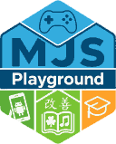

---
hide:
  - toc
---

MJS Playground · Documentación

# Tu proyecto, bien explicado

Una plantilla común para explicar módulos docentes o aplicaciones. Sustituye esta presentación por la de tu propio proyecto.

[Empezar](guia/index.md){ .md-button .md-button--primary }
[Ejemplos](referencia/index.md){ .md-button }

## Contenidos de ejemplo

- **Guía**

    Un apartado de documentación con páginas agrupadas.

    [Abrir guía](guia/index.md)

- **Referencia**

    Ejemplos de componentes y fragmentos de código.

    [Abrir referencia](referencia/index.md)

!!! note "Plantilla"
    Las secciones son de demostración. Personalízalas en la configuración antes de publicar.
