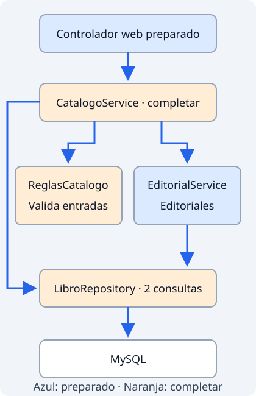

# Servicios, reglas y colaboración

Un formulario correcto desde el punto de vista del navegador todavía puede pedir algo que el negocio no permite. Un stock negativo es un ejemplo. Las reglas deben aplicarse en el **servicio**, de forma que todos los puntos de entrada reciban el mismo comportamiento.

## Repartir las responsabilidades

En el catálogo, el controlador web preparado recibe la entrada, invoca un caso de uso y elige una vista o una redirección. `CatalogoService` coordina el catálogo. `EditorialService` resuelve las operaciones de editoriales. `ReglasCatalogo` concentra comprobaciones compartidas. Los repositorios acceden a la persistencia.

<figure class="mjs-figure" markdown="span">



<figcaption>Colaboración de componentes del catálogo. Elaboración propia; las flechas representan dependencias.</figcaption>
</figure>

No hay un servicio por cada línea de código. Separar `EditorialService` tiene sentido porque encapsula decisiones sobre editoriales que otros casos de uso necesitan. Un coordinador depende de colaboradores con responsabilidades claras; estos no deben volver a llamar al coordinador y crear un ciclo.

## Validar una operación

Las comprobaciones pueden pertenecer a niveles distintos:

| Nivel | Ejemplo |
| --- | --- |
| Entrada web preparada | Convertir un texto a número y mostrar un campo inválido. |
| Servicio y reglas | Precio positivo, stock permitido, editorial existente, ISBN no repetido. |
| Base de datos | Clave externa, columna obligatoria, restricción única. |

Las comprobaciones se complementan. Desactivar JavaScript no debe permitir un stock inválido. Una comprobación previa de ISBN no elimina la necesidad de una restricción única en la tabla.

Antes de guardar, el servicio carga los datos necesarios y normaliza los textos según su contrato. No debe corregir silenciosamente una cantidad imposible. Para importes usamos `BigDecimal`, como en [las validaciones de Ficheros](../ficheros/arquitectura.md#comprobar-importes-con-bigdecimal); `compareTo` compara el valor y la escala establece las cifras decimales admitidas.

Cuando un cálculo genera más decimales de los admitidos, hay que elegir un criterio de redondeo. `setScale(2, RoundingMode.HALF_UP)` conserva dos decimales y aproxima al valor más cercano; en un empate redondea alejándose de cero. Para los importes positivos del catálogo equivale a resolver el empate hacia arriba. Por ejemplo, `new BigDecimal("3.475").setScale(2, RoundingMode.HALF_UP)` produce `3.48`. El valor de `BigDecimal` es inmutable: el método devuelve otro objeto. Consulta [`RoundingMode`](https://docs.oracle.com/en/java/javase/25/docs/api/java.base/java/math/RoundingMode.html). Este criterio se aplica a cálculos; una entrada con demasiados decimales puede rechazarse por la regla de precio en lugar de corregirse silenciosamente.

## Solicitudes y resultados inmutables

Un `record` agrupa datos y ofrece un constructor y métodos de acceso; sus campos finales impiden reasignar sus referencias, pero no vuelven inmutable una lista guardada en ellos. Para entregar un resultado estable, [`List.copyOf(lista)`](https://docs.oracle.com/en/java/javase/25/docs/api/java.base/java/util/List.html#copyOf(java.util.Collection)) crea una lista no modificable que no refleja las modificaciones posteriores de la lista original. Esa copia es superficial: sus elementos también deben ser inmutables si queremos impedir cambios en el contenido. El modelo preparado `Presupuesto` utiliza esta copia defensiva y líneas que son records con valores inmutables, como `String` y `BigDecimal`; así la vista recibe un resultado sin poder alterar sus líneas.

## Propiedades como dependencia

El máximo de stock es configuración del catálogo, no una constante repetida en tres formularios. `CatalogoProperties` agrupa esa configuración y `ReglasCatalogo` la recibe para aplicar el mismo límite. El perfil `practica` reduce el máximo a 50; el valor habitual es 1000. Un cambio de perfil puede hacer inválida una entrada que antes cabía: comprueba el perfil antes de atribuir el resultado a un error del algoritmo.

El enlace entre propiedades y objetos se realiza con [`@ConfigurationProperties`](https://docs.spring.io/spring-boot/3.5/reference/features/external-config.html#features.external-config.typesafe-configuration-properties). Un objeto de configuración no debe utilizarse como almacén mutable del formulario actual.

## Excepciones y causas

Una excepción de dominio expresa un rechazo esperado del caso de uso: ISBN repetido, editorial inexistente o stock fuera de rango. Permite que el controlador preparado muestre el mensaje sin enseñar detalles de MySQL.

Un fallo de persistencia no significa que los datos sean incorrectos. Si envolvemos un error técnico, conservamos su causa para diagnosticarlo. Este fragmento ilustrativo muestra la estructura, sin exigir envolver todas las excepciones de Spring:

```java
catch (DataAccessException causa) {
    throw new PersistenciaCatalogoException(
        "No se pudo guardar el catálogo", causa);
}
```

La excepción propia necesita un constructor que llame a `super(mensaje, causa)`. Spring ya traduce múltiples errores de persistencia a su jerarquía `DataAccessException`; no hay que capturarlos solo para devolver `false`. Si dejamos pasar un error transaccional hasta el límite preparado, el framework puede efectuar el rollback correspondiente.

Registra los errores técnicos con su excepción completa y un contexto útil, sin contraseñas. El mensaje visible para la persona y la traza del desarrollador tienen fines diferentes. Usa [logging y depuración](../ayuda/diagnostico.md) para seguir los argumentos que recibió el servicio y la causa original.

## Eventos: comunicar un hecho

Una llamada directa es adecuada si un caso de uso necesita una respuesta para continuar. Un evento permite anunciar algo que **ha ocurrido** sin conocer cada observador. El catálogo publica `CambioCatalogo`; un observador notifica el cambio mediante el contrato `Notificador`.

Un evento de aplicación es un objeto Java. El publicador utiliza `ApplicationEventPublisher`. Este ejemplo reducido muestra la intención dentro de una operación:

```java
eventos.publishEvent(new CambioCatalogo(libro.getId(), "GUARDAR_LIBRO", reloj.instant()));
```

El evento incluye el identificador afectado, la operación y el instante obtenido con el reloj inyectado. El fragmento se sitúa dentro de la operación de guardado. Publicar no envía automáticamente una petición de red ni crea una cola duradera. Por defecto, los eventos de Spring se procesan en el mismo proceso y no constituyen un sistema de mensajería distribuida. La [referencia de eventos del contexto](https://docs.spring.io/spring-framework/reference/6.2/core/beans/context-introduction.html#context-functionality-events) explica el mecanismo.

El observador del proyecto utiliza `@TransactionalEventListener(phase = AFTER_COMMIT)`: espera a que la operación confirme sus cambios. Si el caso de uso hace rollback, no anuncia un éxito que no ocurrió. Esto requiere publicar durante una transacción activa; sin ella el comportamiento predeterminado de ese listener es no ejecutarse. Consulta [eventos vinculados a transacciones](https://docs.spring.io/spring-framework/reference/6.2/data-access/transaction/event.html).

Un fallo de notificación después del commit **no puede deshacer** el cambio confirmado. Esta notificación de demostración no ofrece entrega garantizada, reintentos duraderos ni envío exactamente una vez. Una operación esencial para mantener consistencia pertenece a la transacción, no a un aviso posterior.

## Interfaces y pruebas

`Notificador` permite sustituir la notificación sin modificar el caso de uso. El perfil `silencioso` selecciona la variante que no escribe el aviso. Debe existir un único candidato para la inyección; no actives implementaciones incompatibles simultáneamente.

Un servicio que recibe colaboradores por constructor permite probar reglas con datos controlados. Una prueba que crea el servicio con `new` comprueba Java ordinario, **no** el proxy de `@Transactional` ni el listener gestionado por Spring. Esas colaboraciones requieren una prueba con contexto y persistencia real cuando corresponda.

En [el guiado](proyecto.md), comprueba las reglas con entradas correctas e incorrectas y observa qué eventos aparecen tras un guardado confirmado.
